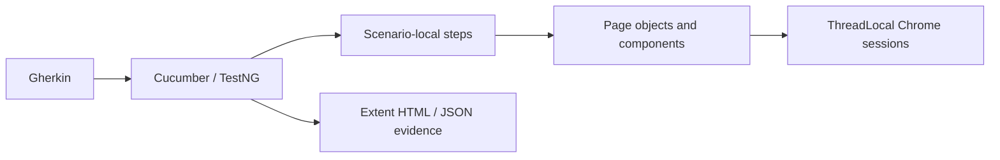

# Automation Exercise — Selenium Java Cucumber Framework

[](https://github.com/srenevasanks/selenium-java-cucumber-framework/actions/workflows/automation.yml)

**[Open Extent report](https://srenevasanks.github.io/selenium-java-cucumber-framework/extent-report.html) · [Open Cucumber report](https://srenevasanks.github.io/selenium-java-cucumber-framework/cucumber.html)**

A Java 17 UI automation portfolio project for [Automation Exercise](https://automationexercise.com/). Tests exercise the public application through Chrome: account registration, authentication, product discovery, cart calculations, checkout and synthetic demo order confirmation.

The framework uses Cucumber JVM, TestNG, Selenium WebDriver, Maven, Page Objects, Extent HTML reporting and SLF4J/Logback. Scenarios have independent browser sessions and unique disposable users. There are no automatic retries, skipped failing scenarios or fabricated report statistics.

See [actual execution results](docs/execution-summary.md), [coverage](docs/test-coverage.md) and [architecture](docs/framework-architecture.md).

## What this project demonstrates

The suite validates complete customer journeys rather than isolated element clicks. Gherkin describes the business behavior, step definitions coordinate scenario state and assertions, and page objects encapsulate Selenium interactions. ThreadLocal drivers, scenario-local customers, explicit waits, account cleanup and event-driven reporting support independent parallel execution.

| Coverage | Live scenarios |
|---|---:|
| Registration and form validation | 8 |
| Login, logout and invalid credentials | 4 |
| Search, product details, categories and brand filtering | 6 |
| Cart quantities, totals, removal and persistence | 7 |
| Checkout validation and simulated order confirmation | 4 |
| Complete customer journey | 1 |

Eight additional browser component checks exercise advertisement dismissal and input/navigation synchronization. See the coverage document for individual assertions and unsupported application features.



Verified on 15 October 2026: **two consecutive complete visible Chrome runs passed**, each with **30 live scenarios + 8 browser component checks, 0 failures and 0 skips**, using **2 observed concurrent scenarios**. Maven completed in **3:46** and **3:31**. The latest Extent report contains the 30 live scenarios; Surefire contains all 38 tests. Both run summaries are retained in [reports/repeatability/](reports/repeatability/). These are dated execution results, not a guarantee about future public-demo availability.


## Quick start

Install Java **17**, Maven **3.9+**, Git and Google Chrome. An internet connection is required for the demo site, Maven Central and Selenium Manager's first driver download.

1. Clone this repository or extract the project ZIP.
2. Open a terminal **inside the directory containing `pom.xml`**.
3. Check `java -version` and `mvn -version`. Maven must report Java 17.
4. Run `mvn clean test`.
5. Open `reports/extent-report.html` in Chrome after Maven finishes.

```bash
git clone https://github.com/srenevasanks/selenium-java-cucumber-framework.git
cd selenium-java-cucumber-framework
mvn clean test
```

No database, local store installation, existing user account or real payment credentials are required. Selenium Manager finds Chrome and its driver automatically.

In addition to the 30 public-site Cucumber scenarios, Maven runs eight deterministic browser component checks. These use temporary HTML fixtures on an ephemeral loopback port to cover direct, nested, zero-sized-wrapper and late-appearing advertising frames, retained URL markers, a link consumed by an ad, category expansion consumed by an ad, and offscreen fields with smooth scrolling and a bottom banner. They are reported separately in TestNG; Extent's scenario totals describe the 30 live application scenarios.

For this configured Windows computer, see [RUN-ME.md](RUN-ME.md). For Eclipse, see [IDE setup](docs/local-ide-setup.md).

## Technology

| Component | Version |
|---|---|
| Java language target | 17 |
| Selenium WebDriver | 4.35.0 |
| Cucumber JVM | 7.27.2 |
| TestNG | 7.11.0 |
| Extent Reports | 5.1.2 |
| Jackson JSON | 2.19.2 |
| SLF4J / Logback | 2.0.17 / 1.5.18 |
| Maven Compiler / Surefire | 3.14.0 / 3.5.3 |

Versions are pinned in the POM. The implementation uses standard W3C WebDriver commands; Chrome DevTools integration is not required.

## Commands

Run all 30 live scenarios plus 8 component checks, headlessly with up to 2 concurrent scenario workers by default:

```bash
mvn clean test
```

Run smoke (8 scenarios), regression (30), or a module:

```bash
mvn clean test -Dcucumber.filter.tags="@smoke"
mvn clean test -Dcucumber.filter.tags="@regression"
mvn clean test -Dcucumber.filter.tags="@cart"
```

Headless or visible Chrome:

```bash
mvn clean test -Dheadless=true
mvn clean test -Dbrowser=chrome -Dheadless=false
```

On PowerShell, quote each complete system-property argument if necessary:

```powershell
mvn clean test "-Dcucumber.filter.tags=@smoke" "-Dheadless=false"
```

## Parallel execution

Parallel execution is enabled by default with **2 scenario workers** for visible IDE and headless execution. An earlier eight-worker headless run passed, but subsequent visible IDE runs were unreliable; that single success did not establish repeatability. The worker limit is deliberately conservative while retaining parallel support. Each worker runs one scenario at a time; 30 scenarios do not launch 30 simultaneous browsers. The eight short component checks execute separately from the parallel Cucumber provider.

Run with the default settings, or specify the worker count explicitly:

```bash
mvn clean test
mvn clean test -Dscenarios.parallel=true -Dthreads=2 -Dheadless=true
mvn clean test -Dscenarios.parallel=true -Dthreads=2 -Dheadless=false
mvn clean test -Dscenarios.parallel=true -Dthreads=2
mvn clean test -Dscenarios.parallel=false
```

For visible execution in Eclipse, use Maven goals `clean test -Dheadless=false`; the POM supplies the parallel defaults. The included **Parallel - Visible Chrome.launch** configuration also sets 2 workers explicitly. Remove any old `-Dthreads=8` override from existing run configurations. The worker count remains configurable, but higher values require separate repeatability validation. Do not use Maven `-T` to control scenario concurrency: `threads` configures TestNG's parallel data provider.

Each scenario has its own driver, cookies, account and state. Extent records the configured worker limit and observed peak concurrent scenarios. Do not run two Maven processes against the same checkout simultaneously because they write the same report paths. GitHub Actions explicitly uses **2 workers** for its runner rather than inheriting the local setting.

## Configuration and data

Defaults: `src/test/resources/config/config.properties`. Java system properties override file values. Supported keys: `baseUrl`, `browser`, `headless`, `wait.seconds`, `pageLoad.seconds`, `scenarios.parallel`, `threads`, `chrome.binary` and `remote.url`. Only Chrome is supported. For a Selenium Grid, run the live scenarios with `-Dtest=RunCucumberTest -Dremote.url=http://your-grid:4444`; the component fixtures use a local loopback server and are validated separately with local Chrome.

Product prices, identifiers and address fixtures are in `src/test/resources/testdata/store.json`. These are deliberate expectations against known public demo products, not live values copied into assertions. Price changes should be investigated before updating fixtures.

Unique `example.com` emails and random passwords are generated in memory. No reusable credentials are stored. Successful account creation is tracked per scenario, and an after hook deletes that disposable account, logging back in if necessary. Cleanup failures fail the scenario. A crash or service outage can leave synthetic test data behind.

Payment uses clearly synthetic values, including an all-zero card number. This is the practice site's simulated checkout, not payment-gateway validation. Never configure these tests against a real shop.

## Project structure

```text
.github/workflows/automation.yml
src/main/java/framework/
  config/        Properties configuration
  driver/        ThreadLocal Chrome / remote driver lifecycle
  components/    Header navigation and ordinary advertisement controls
  pages/         Registration, login, catalog, product, cart and checkout
  utils/         Synthetic customers, JSON fixtures and decimal money parsing
src/test/java/
  components/    Deterministic ad-handler browser regression checks
  hooks/         Browser lifecycle, failure and E2E screenshots
  runners/       Cucumber / TestNG discovery and parallel execution
  stepdefinitions/ Business-step orchestration and assertions
  reporting/     Extent event listener
src/test/resources/
  features/      Six functional feature files
  config/        Execution defaults
  testdata/      Synthetic addresses and catalog fixtures
reports/         Generated HTML, Cucumber JSON and execution summary
screenshots/     Generated PNG evidence
docs/            Coverage, architecture, execution and IDE guide
```

## Reports and CI

The links at the top open the saved Extent and Cucumber HTML reports directly in the browser. GitHub Pages serves the report files only; there is no portfolio or landing page. Both reports show the same completed run recorded on 15 October 2026: 30 live scenarios passed, zero failures and zero skips, with two observed concurrent scenarios. The eight separate component checks are covered in Surefire and the execution summary. These links show the checked-in snapshot; later CI runs provide their own artifacts.

Every real run generates:

- `reports/extent-report.html`: dates, duration, feature/scenario names, individual steps, errors, browser/environment details, counts and pass percentage.
- `reports/execution-summary.json`: machine-readable actual totals.
- `reports/cucumber.html` and `reports/cucumber.json`: standard Cucumber output.
- `screenshots/*.png`: failures and completed E2E order confirmation, also embedded in Extent.
- `target/surefire-reports/`: Maven/TestNG results.
- `reports/execution.log`: application logging.

Reports represent the most recent command. Save a copy before a new run if you need history. A dated portfolio snapshot of the latest HTML/JSON and Surefire results is retained under `reports/` in Git and in the delivery ZIP. Subsequent runs overwrite these tracked report files with their own results; review those changes before committing. Execution logs and runtime screenshot files remain ignored; the dated order-confirmation image under `docs/images/` is versioned. Report counts are generated from execution events, never manually filled in.

GitHub Actions runs all scenarios on pushes and pull requests with Java 17 and Chrome, and uploads reports/screenshots even after failures. Maven failures remain failed workflow runs. The workflow needs no secrets. GitHub-hosted execution must be verified after pushing to your own repository; local success is not a claim that a remote workflow has run.

## Troubleshooting and limitations

- **Wrong Java:** set `JAVA_HOME` to a JDK 17 directory and open a new terminal; check Maven's reported JVM.
- **Driver cannot launch:** run from a normal terminal with permission to execute ChromeDriver. Do not disable endpoint protection. For diagnostics, inspect Maven's first driver exception.
- **Driver download/network failure:** ensure Chrome, Maven Central, Selenium driver downloads and the public site are reachable.
- **CDP version warning:** current Chrome can be newer than Selenium's optional DevTools modules. These tests use W3C WebDriver; a CDP warning alone does not indicate a failed test.
- **Ordinary ad popups:** the framework checks before interactions and after clicks, waits for an exposed vignette Close control and restores the main page context. Close controls inside nested advertising frames are supported. An ad may appear briefly while loading; leave automated Chrome open so the handler can close the ad and resume the pending action. The framework does not block advertising requests, remove live ad DOM nodes or bypass security controls.
- **Security verification or demo outage:** retain the failure, screenshot and error. Do not solve challenges automatically or weaken assertions.
- **Test fails:** open Extent, expand the failed step and inspect its screenshot. Reproduce using the module tag. There are no hidden retries.
- Wishlist, sorting, password confirmation, inline cart quantity editing and selectable shipping/payment methods are not exposed in the inspected application. They are not represented by placeholder tests. Quantity selection and cumulative additions are covered instead.
- Required address information is supplied during registration; checkout reviews it. Required-field tests use the browser's native validity state and message rather than English-only popup text.

Possible future improvements: additional review/contact/subscription scenarios, invoice-file assertions, more category combinations and a CI browser-version matrix. These are outside the implemented coverage.

MIT licensed.

To run only the ad-component regression checks:

```bash
mvn test -Dtest=AdvertisementTest
```
