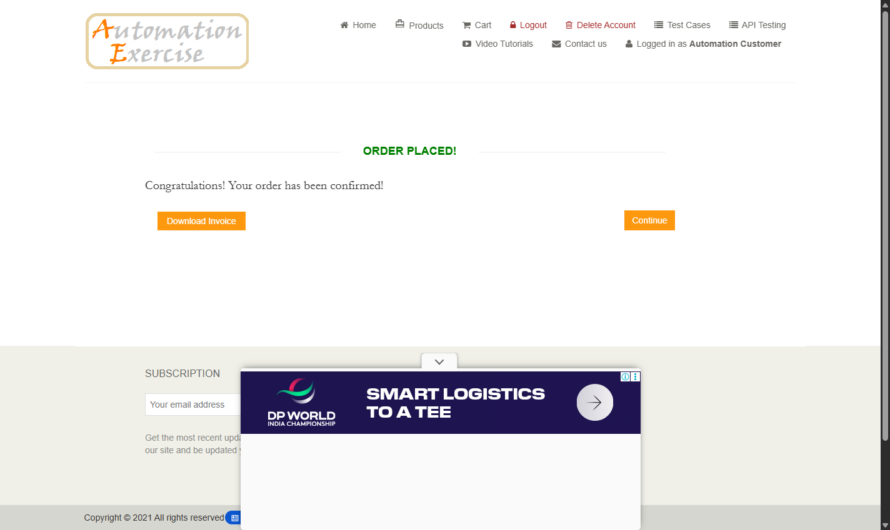

# Actual execution evidence — 15 October 2026

Application: https://automationexercise.com/

## Latest repeatability verification

The same completed source was run twice consecutively with visible Chrome and two parallel scenario workers:

```bash
mvn clean test -Dheadless=false
```

| Actual run | Live Cucumber scenarios | Browser component checks | Failures / errors / skips | Observed peak scenarios | Maven duration |
|---|---:|---:|---|---:|---|
| Run 1, finished 21:20:49 Asia/Calcutta | 30 passed | 8 passed | 0 / 0 / 0 | 2 | 3 minutes 46 seconds |
| Run 2, finished 21:24:55 Asia/Calcutta | 30 passed | 8 passed | 0 / 0 / 0 | 2 | 3 minutes 31 seconds |

Run 1 started Cucumber at 2026-10-15T15:47:19.688429400Z; Cucumber recorded 208 seconds and TestNG 221.1 seconds. Run 2 started Cucumber at 2026-10-15T15:51:42.623821100Z; Cucumber recorded 192 seconds and TestNG 205.7 seconds.

Cucumber JSON, the Extent event summary and Surefire XML agree: all 6 feature files and 30 live scenarios executed, every live step and hook passed, and Surefire recorded 38 tests with zero failures, errors or skips. Extent intentionally counts the 30 live Cucumber scenarios; the eight deterministic browser component checks are recorded by TestNG/Surefire.

- [Latest Extent HTML](../reports/extent-report.html)
- [Latest actual summary JSON](../reports/execution-summary.json)
- [Latest Cucumber JSON](../reports/cucumber.json)
- [Latest Surefire totals](../reports/surefire/TestSuite.txt)
- [Run 1 summary](../reports/repeatability/run-1-summary.json) and [Extent HTML](../reports/repeatability/run-1-extent-report.html)
- [Run 2 summary](../reports/repeatability/run-2-summary.json)
- [Portfolio snapshot](latest-execution.json)



## Failures investigated and corrected

The user's latest visible eight-worker report had **14 live scenarios passed and 16 failed**. Navigation remained on the source page in several failures; input clearing also raised InvalidElementStateException. Screenshots showed ordinary ads and clear source pages rather than the expected destination. Failed evidence was archived outside the delivery before rerunning.

An initial two-worker visible diagnostic run still failed five live scenarios. Lower concurrency alone was therefore insufficient. The interaction changes were:

- Center both inputs and links with instant scrolling; check the actual target center with a read-only DOM hit test before native clear, typing or clicks. This prevents actions during smooth-scroll movement or through fixed bottom banners.
- Track successful native advertisement dismissals. If an ad consumed a navigation link and the browser remains on the unchanged source page, continue that same link once. Form submissions and whole scenarios are not retried.
- Verify category expansion before using its child link. A subsequent full run reached 29 live passes with one category failure because an ad closed but the category stayed collapsed. A bounded continuation after a real dismissal now checks that the panel actually opens.
- Add browser fixtures for ad-consumed navigation, ad-consumed category expansion and offscreen fields with smooth scrolling and a fixed banner. These supplement the existing five advertisement cases.

The focused catalog rerun passed all six public catalog scenarios and all eight component checks. Both complete visible runs above then passed without further source changes. Business assertions were not weakened, and no failed scenario was removed or skipped.

The component fixtures are self-owned HTML served temporarily on an ephemeral loopback port. They do not install a local store or replace public-application execution. The framework uses exposed advertising Close controls; it does not block ad requests, remove public-site ad DOM nodes, solve CAPTCHA or bypass security controls.

## Parallel default and earlier verification

Defaults are now **scenarios.parallel=true**, **threads=2**, **headless=true**. The visible Eclipse command overrides only headless. The portable Parallel - Visible Chrome launch configuration explicitly uses two workers. Remove an older threads=8 override from a custom IDE configuration.

An earlier eight-worker headless run genuinely passed 30 live scenarios plus the then-existing five component checks in 1 minute 53 seconds, but later visible runs were unreliable. That single pass did not establish a repeatable maximum. Eight workers is no longer the recommended default. Higher worker counts remain configurable and require separate repeatability validation.

Before these interaction changes, the migrated suite also passed a sequential headless full run and visible/two-thread headless smoke runs. The latest two complete verification runs above were visible; they do not claim that every execution mode or remote environment was rerun after the changes.

## Environment and boundaries

Windows 11, Java 17.0.12, Maven 3.9.11, Chrome 155.0.8059.40, Selenium 4.35.0, Cucumber 7.27.2 and TestNG 7.11.0. JAVA_HOME points at JDK 17. Scenario browsers and disposable accounts are independent. Cleanup deletes only the account created by that scenario; an interrupted run can leave synthetic data behind.

The public checkout is simulated and uses synthetic payment values. Successful confirmation does not validate a real payment gateway. Public-site availability, advertising and product data can change independently of this repository; future failures remain visible in Maven and reports.

GitHub Actions explicitly uses two workers and preserves failures while uploading evidence. The workflow has not been dispatched against the user's repository, so local passes are not a claim of hosted CI success.

Selected actual HTML/JSON, repeatability summaries and Surefire evidence are retained under reports for the portfolio. Runtime logs and screenshot files remain ignored by Git; the dated order image under docs is versioned. Subsequent runs regenerate the main reports from their own results. Earlier failed evidence and older application code remain archived outside the project and ZIP.
