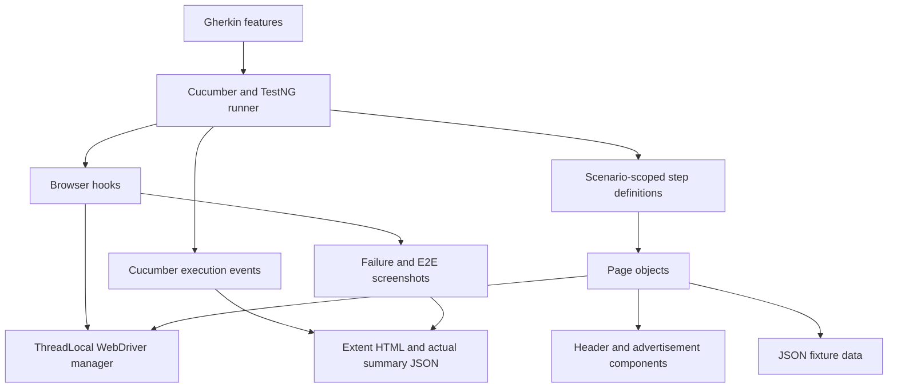

# Framework architecture

The framework separates business examples, test orchestration and browser behavior.

## Responsibilities

- Configuration loads properties once; JVM properties override defaults.
- DriverManager owns Chrome creation, optional headless/remote execution and teardown. ThreadLocal storage prevents cross-thread driver sharing.
- Cucumber creates separate step-definition/hook instances per scenario. User credentials and registration state remain scenario-local.
- Page objects own locators, interaction and explicit waits. The base page centralizes navigation, input, rendered-text normalization and native browser validation inspection.
- Both links and inputs are centered with instant scrolling, followed by a read-only DOM hit test at the target center. This avoids acting during smooth scroll animation or through a fixed banner. Clear, typing and clicks remain native WebDriver operations. A dismissed ad that consumed a link click permits one continuation of that same link only while the browser remains on the original page; form submissions and whole scenarios are not retried.
- Header is a reusable navigation component. Advertisement handles only ordinary vignette close controls. Native WebDriver clicks remain in use; JavaScript is limited to scrolling and read-only HTML validity inspection.
- Ad checks run before element interactions and after native clicks, including non-navigation actions such as expanding a category. A bounded traversal looks for the observed Close control only inside known Advertisement frames and their descendants. Frame context is restored after inspection. A click intercepted by a recognized vignette waits for dismissal; unrelated interception still fails. This is interaction synchronization, not a scenario retry.
- Close targets must have a positive rendered area; a visible child of a zero-sized control wrapper can receive the native click. Active-ad detection checks visible frame geometry and usable Close controls because Google's URL fragment can remain after the overlay has gone. A large visible advertising frame remains blocking while its controls load. The application must still satisfy its normal navigation and business assertions after dismissal.
- JSON products are fixed expected data. Decimal money parsing avoids binary floating-point rounding.
- Steps express workflow and meaningful assertions. They do not contain raw Selenium element operations.
- Cleanup runs after evidence capture and before browser teardown. It deletes only the unique disposable account created by that scenario, using the UI and in-memory credentials. Cleanup errors are reported.
- Extent is populated by actual Cucumber events. UUID-keyed concurrent mappings and atomic counters support parallel scenarios.

## Execution

The TestNG runner exposes sequential and parallel data providers. The `scenarios.parallel` property selects exactly one. The `threads` property controls parallel data-provider concurrency.

Defaults are `scenarios.parallel=true` and `threads=2`; GitHub Actions explicitly selects 2 workers. Maven `-T` is not the scenario scheduler. Component checks execute separately from the Cucumber provider. Extent uses atomic active/peak counters to record observed concurrent scenarios as well as the configured limit; the summary JSON exposes both values for verification.

Each scenario opens a new browser. There are no static accounts, dependent scenarios or automatic test retries. A public-site failure is visible in Maven's exit code, Cucumber and Extent.

Screenshots are captured before cleanup when a step fails. An additional teardown check captures cleanup failures. Successful E2E journeys attach their actual order-confirmation screenshot.

## Tradeoffs

UI account creation keeps setup transparent and verifies actual registration, at the cost of execution time. The shared public application and advertising may change independently of this repository. Locators prefer observed IDs, `data-qa` attributes and scoped CSS selectors. There are no invented service layers, unused exception hierarchies or security-bypass mechanisms.

## Ad-component regression checks

`components.AdvertisementTest` adds eight deterministic Selenium checks alongside the live Cucumber suite. A JDK HttpServer binds only to loopback on an ephemeral port and serves small, self-owned fixtures. Native Close clicks must update observable fixture state and allow the next page action. The nested case also proves restoration of the main frame context. The late-ad case proves that post-click synchronization dismisses an overlay triggered without navigation. These are component checks, not substitutes for live application scenarios; they appear in TestNG results rather than Extent's Cucumber totals.

Two fixtures also verify continuation of an ad-consumed link and native field editing across a smooth-scrolling page with a fixed bottom banner. The fixture Close handlers remove their own fixture overlays; the framework never removes public-site ad DOM nodes.
